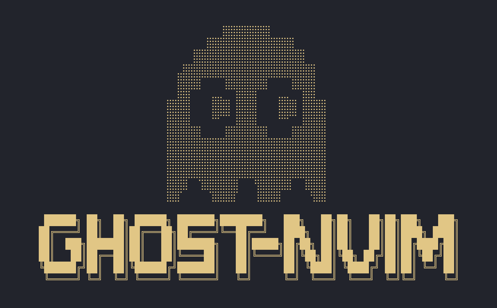

<p align="center">
  
</p>

<h4 align="center">
  <a href="#installation">Install</a>
  ·
  <a href="#make-it-yours">Configure</a>
  ·
  <a href="#shortcuts">Shortcuts</a>
  ·
  <a href="#tests">Tests</a>
</h4>

<p align="center">
  <a href="https://github.com/manwwe/ghost-nvim/releases/tag/v0.1.1">
    
  </a>
  <a href="https://neovim.io/">
    
  </a>
  <a href="https://github.com/manwwe/ghost-nvim/commits/main">
    
  </a>
  <a href="LICENSE">
    
  </a>
  <a href="https://github.com/manwwe/ghost-nvim/issues">
    
  </a>
  <a href="https://github.com/manwwe/ghost-nvim">
    
  </a>
</p>

# Ghost-nvim

My personal Neovim configuration, built from scratch with Lua and lazy.nvim.
Made for the way I code: project work, competitive programming, and a terminal
close at hand.

This is a personal setup, not a Neovim distribution. Feel free to copy it,
borrow individual pieces, or make it your own. Some settings target my Apple
Silicon Mac, so check the machine-specific notes before using the runners.

## What's inside

- **Nordic** with custom operator and punctuation colors; nine other themes to try.
- **Blink completion** with LSP, snippets, paths, buffer words, and optional Copilot.
- **Mason + nvim-lspconfig** for language servers, with settings grouped by language.
- **Tree-sitter** highlighting, folding, and text objects.
- **Conform** for formatting; **nvim-lint**, Ruff, Clippy, and ESLint for diagnostics.
- **Neo-tree**, **Snacks Picker**, **LazyGit**, and optional **mini.diff** signs.
- **Snacks terminals** and floating file runners, including a Codeforces input mode.
- **Alpha**, **lualine**, **bufferline**, **Noice**, and **which-key**.
- **mini.surround**, **nvim-autopairs**, **visual-whitespace**, and **CodeSnap**.

## Try it

### Requirements

- Neovim **0.12+**, Git, and a terminal with true-color support.
- A **Nerd Font** selected in your terminal for icons.
- `ripgrep` for text searches; `fd` is recommended for file searches.
- `curl`, `tar`, a C compiler, and **tree-sitter-cli 0.26.1+** for parsers.
- Node.js and npm for the JavaScript-based language tools.
- `lazygit` for the Git interface.

Install language runtimes and toolchains for the languages you use. The runners
also expect `lua`, `python3`, and `bash` on your PATH.

### Installation

If you already have a Neovim configuration, move it aside first. This backs up
the configuration only; it leaves your Neovim data and state directories alone.

```sh
if [ -e "$HOME/.config/nvim" ] || [ -L "$HOME/.config/nvim" ]; then
  mv "$HOME/.config/nvim" "$HOME/.config/nvim.backup-$(date +%Y%m%d-%H%M%S)"
fi

mkdir -p "$HOME/.config"
git clone https://github.com/manwwe/ghost-nvim.git "$HOME/.config/nvim"
nvim
```

On first launch, lazy.nvim installs the plugins. Let plugin, language-server,
and parser installation finish, then restart Neovim. Internet access is needed.

Useful checks:

```vim
:Lazy
:Mason
:checkhealth
:ConformInfo
```

### Formatters and linters

Mason-lspconfig installs the configured language servers. Standalone formatters
are separate; install these through Mason or your package manager:

```vim
:MasonInstall stylua shfmt clang-format prettier
```

Shell linting needs `shellcheck`. Rust checking uses `cargo clippy` in Cargo
projects; install the component with `rustup component add clippy` if needed.
ESLint needs a project-local ESLint installation and an ESLint configuration.

Formatting is manual with `Space cf`. The `BufWritePre` event loads Conform;
it does not enable format-on-save.

### Machine-specific C/C++ settings

The C/C++ runners use Homebrew **GCC 16**, not Apple's Clang:

```text
/opt/homebrew/bin/gcc-16
/opt/homebrew/bin/g++-16
```

Update these paths in `lua/ghost/config/runner.lua` and the clangd query-driver
setting in `lua/ghost/plugins/lang/cpp.lua` for your machine. C runs as C11;
C++ runs as C++20. These runners build individual files, not full projects.

`bits/stdc++.h` is a GCC header. The query-driver allowlist alone does not tell
clangd which compiler a project uses: provide the appropriate compiler through
`compile_commands.json` or your clangd configuration. My external clangd
preferences are not included in this repository.

## Shortcuts

The leader is **Space**; the local leader is **backslash**. Press Space and pause
to browse the groups in which-key. The sequences below start with Space.

| Shortcut | Action |
| --- | --- |
| `e` / `E` | Explorer at project root / current directory |
| `ff` / `fr` | Find files / recent files |
| `fg` / `/` | Search project / current buffer |
| `Space` | Find buffers — press Space twice |
| `fs` / `fS` | Save / save without autocommands |
| `bb` / `bd` / `bo` | Other buffer / delete buffer / delete other buffers |
| `ca` / `cr` / `cd` | Code actions / rename / line diagnostics |
| `cf` | Format buffer or Visual selection |
| `cs` | Save a code screenshot from Visual mode |
| `gg` / `gb` / `gl` | LazyGit / Git branches / commit history |
| `gd` / `go` | Toggle diff tracking / diff overlay |
| `wv` / `ws` | Vertical / horizontal split |
| `wh`, `wj`, `wk`, `wl` | Focus left / down / up / right window |
| `w` + arrow | Resize window |
| `tt` / `tf` | Bottom / floating terminal |
| `tl` / `tv` | Left / right terminal |
| `tr` / `tc` | Run file immediately / collect input first |
| `ua` | Toggle Copilot |
| `ug` / `ud` / `uh` | Toggle indent guides / diagnostics / inlay hints |
| `uw` / `us` | Toggle wrapping / spell checking |
| `xq` / `xl` | Quickfix / location list |
| `qq` | Quit all |

`Ctrl+n/p` navigates completion suggestions. Tab and Enter accept an explicitly
selected suggestion. `jj` leaves Insert mode or terminal input mode.
`Ctrl+/` (or `Ctrl+_`, depending on the terminal) toggles the bottom terminal.

mini.diff starts disabled. Enable it with `Space gd` before using `Space go`.

### Competitive programming

Both runners save modified files and open a floating terminal. Output stays
visible after the process exits. Supported filetypes: C, C++, Lua, Python, Bash.

- **Space tr:** run immediately and interact with the program normally.
- **Space tc:** paste the test input, then press **Ctrl+d on an empty line**.
  The runner prints `--- output ---` before executing with the collected input.

### GitHub Copilot

Copilot is **disabled at every startup**. Enable it with **Space ua**, then run
`:Copilot auth` to sign in if needed. A GitHub account with Copilot access is
required. The server may download on first activation.

Suggestions appear inside **Blink's menu**, alongside normal completion sources.
Inline ghost text is disabled. Use the same Ctrl+n/p and Tab/Enter workflow.
Press Space ua again to disable Copilot.

## Make it yours

```text
init.lua
lua/ghost/
  config/        # Options, keymaps, autocommands, bootstrap, and runners
  plugins/       # Plugin specs and their settings
    lang/        # Language-specific servers, parsers, formatters, and linters
    lsp/         # Mason and shared LSP configuration
    theme/       # One file per colorscheme
tests/           # Headless configuration checks
```

Start with `config/options.lua` and `config/keymaps.lua`. Plugin settings live
beside their plugin specs. Nordic is the active startup theme; its colors are
configured in `plugins/theme/nordic.lua`.

Code snapshots are saved to `~/Pictures/CodeSnap/`. They are not written into
the current project.

## Tests

GitHub Actions runs the configuration suite on every push to `main`. You can
also start it manually from the repository's Actions tab.

After installing the plugins, run from the repository:

```sh
./tests/run.sh
```

The suite checks startup, merged language settings, formatting and linting
configuration, Copilot's disabled default, completion behavior, and user keymap
conflicts. See [tests/README.md](tests/README.md) for scope and limitations.

## License

[MIT](LICENSE). Copy it, change it, and build a setup that works for you.
